<!-- Drop your real Mikasa GIF at assets/aotmikasa.gif (replaces the placeholder). -->

<table>
  <tr>
    <td width="40%" align="center" valign="middle">
      
    </td>
    <td width="60%" valign="middle">
      <h2>Hi, I'm Ian 🧣</h2>
      
<b>Computer Science Student · Full-Stack Developer</b> 
      📍 Calamba, Philippines

      
I build both sides of the web: the interface you see and the backend behind it.
      I learn by shipping practical projects and picking up new tools along the way.

      
<i>"This world is cruel, and also very beautiful."</i> That's how I feel about debugging.

      

        
        
      

    </td>
  </tr>
</table>

---

## 🧣 About me

I'm a Computer Science student who enjoys building frontend and backend applications and learning new technologies.
Outside code: photography, badminton, music, and games.

> *Currently building:* **Dear, in Stereo**, a music-sharing platform where songs become private digital letters.

## 🛠 Tech stack

  <b>Languages</b> 
  

  <b>Frontend</b> 
  

  <b>Backend &amp; Database</b> 
  

  <b>Tools &amp; Platforms</b> 
  

## 🌐 Portfolio

 
<a href="https://iandevs.vercel.app/"><b>🔴 Live Site</b></a> &nbsp;·&nbsp; <a href="https://github.com/ifwian/Iandevsu">GitHub Repository</a>

## 📊 GitHub stats

## 📬 Let's connect

  
  
  
  

Tatakae. 🧣

