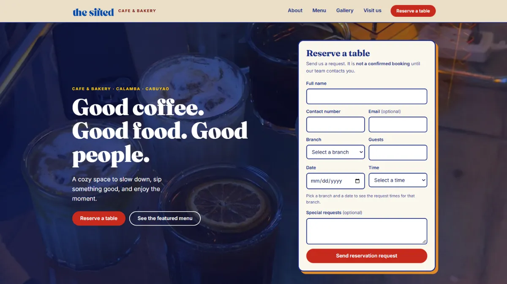
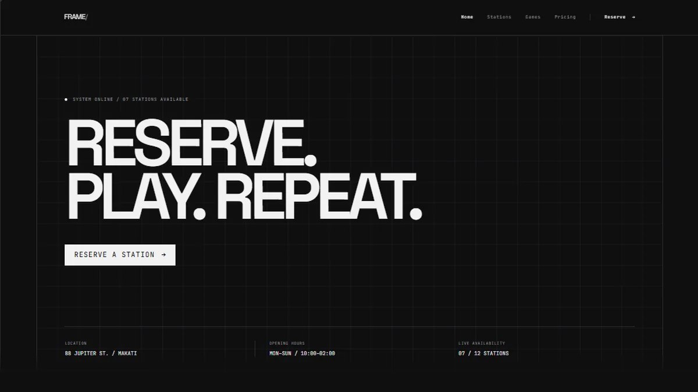
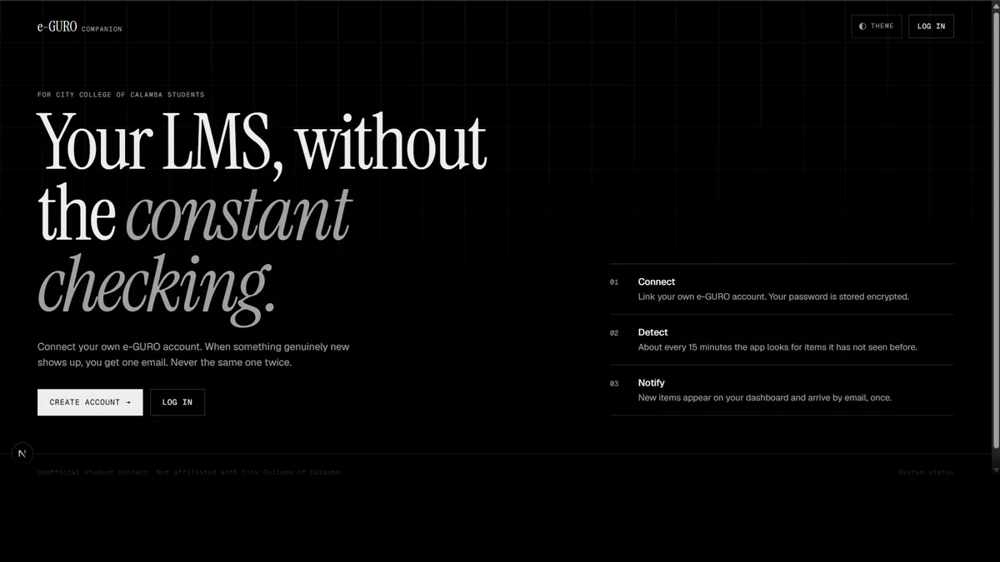
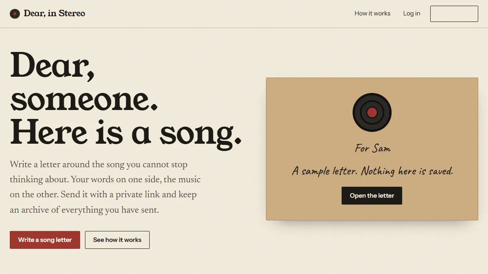
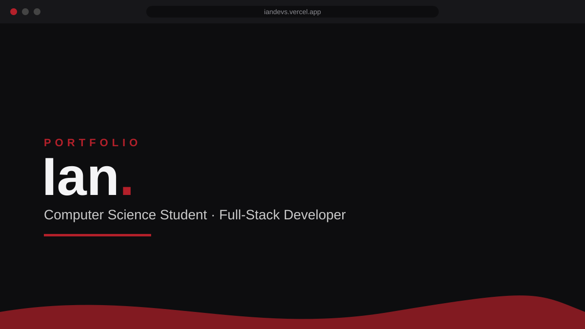

<!-- SWAP BANNER: once you add assets/mikasa.gif, replace the line below with:

(or keep it under the animated banner as a second image) -->

 

**Computer Science Student · Full-Stack Developer**

📍 Calamba, Philippines

 

---

## 🧣 About me

I'm a Computer Science student who enjoys building both the frontend and backend of web applications.
I learn by shipping practical projects, from reservation sites to full-stack apps, and picking up new tools along the way.

Outside code: photography, badminton, music, and games.

> *Currently building:* **Dear, in Stereo**, a music-sharing platform where songs become private digital letters.

## 🛠 Tech stack

  <b>Languages</b> 
  

  <b>Frontend</b> 
  

  <b>Backend &amp; Database</b> 
  

  <b>Tools &amp; Platforms</b> 
  

## 📌 Featured projects

<table>
  <tr>
    <td width="50%" align="center" valign="top">
      <h3>The Sifted Café</h3>
      
        
      <a href="https://thesiftedcafe.vercel.app/"><b>🔴 Live Demo</b></a> &nbsp;·&nbsp; <a href="https://github.com/ifwian?tab=repositories">GitHub Repository</a> <i>(TODO: replace with exact repo link)</i>
    </td>
    <td width="50%" align="center" valign="top">
      <h3>FRAME</h3>
      
        
      <a href="https://theframegamingcafe.vercel.app/"><b>🔴 Live Demo</b></a> &nbsp;·&nbsp; <a href="https://github.com/ifwian?tab=repositories">GitHub Repository</a> <i>(TODO: replace with exact repo link)</i>
    </td>
  </tr>
  <tr>
    <td width="50%" align="center" valign="top">
      <h3>LMS Notifier</h3>
      
        
      <a href="https://lmscompanion.vercel.app/"><b>🔴 Live Demo</b></a> &nbsp;·&nbsp; <a href="https://github.com/ifwian?tab=repositories">GitHub Repository</a> <i>(TODO: replace with exact repo link)</i>
    </td>
    <td width="50%" align="center" valign="top">
      <h3>Dear, in Stereo</h3>
      
        
      <a href="https://dearinstereo.vercel.app/"><b>🔴 Live Demo</b></a> &nbsp;·&nbsp; <a href="https://github.com/ifwian?tab=repositories">GitHub Repository</a> <i>(TODO: replace with exact repo link)</i>
    </td>
  </tr>
  <tr>
    <td width="100%" align="center" valign="top" colspan="2">
      <h3>My Personal Portfolio</h3>
      
        
      <a href="https://iandevs.vercel.app/"><b>🔴 Live Demo</b></a> &nbsp;·&nbsp; <a href="https://github.com/ifwian/Iandevsu">GitHub Repository</a>
    </td>
  </tr>
</table>

## 📊 GitHub stats

## 📬 Let's connect

  
  
  
  

Tatakae. 🧣

