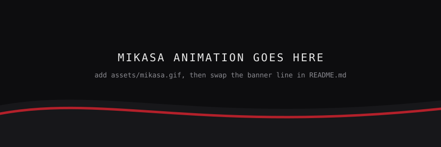

<!-- MIKASA ANIMATION: put your GIF at assets/mikasa.gif (keep it under ~5 MB, about 900px wide),
     then replace "assets/banner-placeholder.svg" below with "assets/mikasa.gif". -->

# Hi, I'm Ian 👋

**Information Technology student · Front-End & Web Development**

Calamba, Philippines

---

## 🧣 About me

I'm an Information Technology student who likes building websites and small apps that people can actually use.
I'm still learning, so a lot of what I know comes from making things, breaking them, and fixing them.
I'm into front-end work, UI/UX, web technologies, and creative side projects.

Outside code: photography, badminton, music, and games.

## 🛠 Tech stack

  <b>Languages</b> 
  

  <b>Frontend</b> 
  

  <b>Backend &amp; Database</b> 
  

  <b>Tools &amp; Platforms</b> 
  

## 📌 Featured projects

<table>
  <tr>
    <td width="50%" valign="top">
      <h3>The Sifted Café</h3>
      
Full-stack café app with a menu, online reservations and an admin dashboard.

      
React · Tailwind CSS · Node.js · Express · PostgreSQL · Prisma

      
<a href="https://thesiftedcafe.vercel.app/">Live demo</a> · Repo: <i>add link</i>

    </td>
    <td width="50%" valign="top">
      <h3>FRAME</h3>
      
Reservation site for a gaming lounge: live station availability, hours, pricing and booking.

      
React · Tailwind CSS

      
<a href="https://theframegamingcafe.vercel.app/">Live demo</a> · Repo: <i>add link</i>

    </td>
  </tr>
  <tr>
    <td width="50%" valign="top">
      <h3>LMS Notifier</h3>
      
Checks a learning management system for new announcements and notifies users.

      
Python

      
<a href="https://lmscompanion.vercel.app/">Live demo</a> · Repo: <i>add link</i>

    </td>
    <td width="50%" valign="top">
      <h3>Dear, in Stereo in progress</h3>
      
A music-sharing platform where songs become private digital letters.

      
React · Tailwind CSS

      
<a href="https://dearinstereo.vercel.app/">Live demo</a> · Repo: <i>add link</i>

    </td>
  </tr>
  <tr>
    <td colspan="2" valign="top">
      <h3>This portfolio</h3>
      
My personal site, with a Gemini-powered "Chat with Ian" assistant and a private admin inbox.

      
React · TypeScript · Vite · GSAP · Supabase · Vercel

      
<a href="https://iandevs.vercel.app/">Live site</a> · <a href="https://github.com/ifwian/Iandevsu">Repository</a>

    </td>
  </tr>
</table>

## 📊 GitHub stats

## 📬 Let's connect

  
  
  
  

